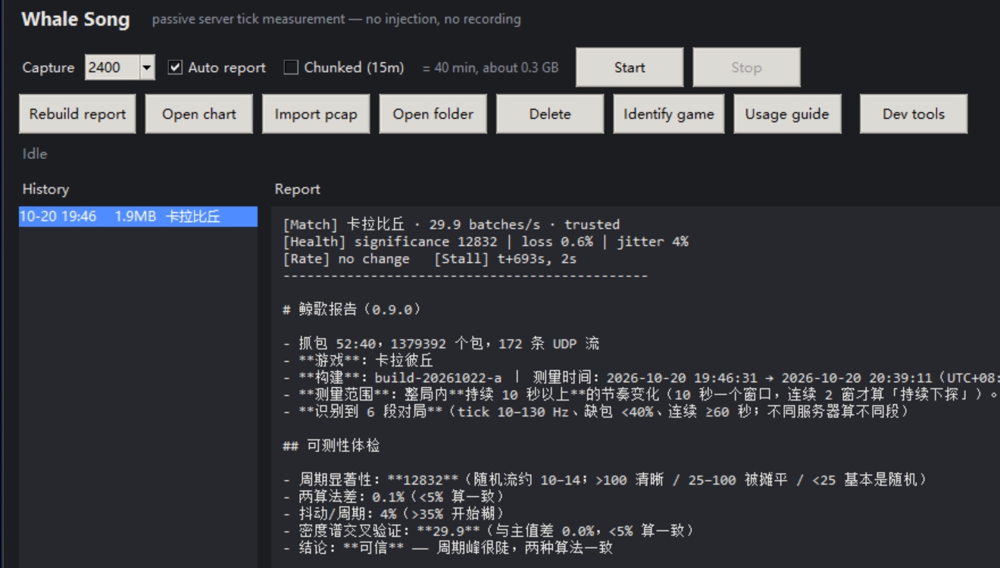
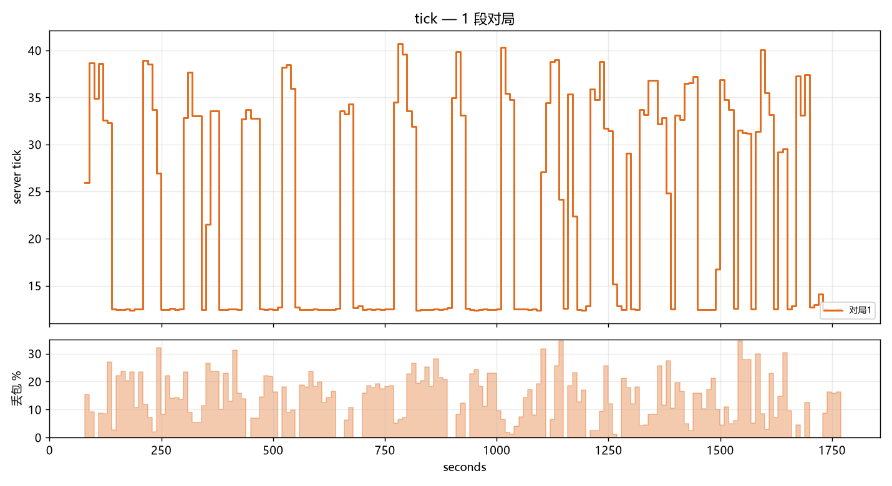

# 鲸歌 · Whale Song

**被动测游戏服务器 tick 的工具——不注入、不读内存、不改游戏。**

用 Windows 自带的抓包，录一局流量，估算服务器发状态包的节奏（tick 近似）。

> 这个仓库只放 **程序下载、文档和 issue**。
> **不放源码。**

---

## 它测什么

服务器发状态包是有节奏的。如果节奏是等间隔的，频谱上会出现一根尖峰，峰的位置就是频率。

每局报告给出：

- **每秒批数**——服务器发包的节奏
- **可信度**——`可信` / `参考` / `不可判`
- **速率变化检查**——这局中间节奏有没有变
- **卡顿**——哪一段没包、停了多久

## 它不声称什么

- **批 ≠ 引擎 tick。** 被动抓包分不出「每秒几个包」和「每秒几帧模拟」。
- **多路复用测不了。** 多条流摊平的场景，报告写 `不可判`。
- **10 秒以内的变化看不见。**
- **「缺包」偏高。** 它包含真实网络丢包，也包含服务器主动少发。

## 安装

1. 在 [Releases](../../releases) 下载最新版 `WhaleSong-1.1.0.zip`
2. 核对 SHA-256（见 Release 说明）
3. 解压到任意目录，双击 `WhaleSong.exe` 或 `鲸歌.exe`（Windows 10/11）

界面支持中英双语，主窗口右下角切换；英文界面会额外生成一份 `report.en.md` 英文摘要。

不用装 Python。工具**不联网**，不会自己上传任何东西。

## 使用

1. 打开，选输入方式，点 **开始记录**
2. 打一局
3. 点 **停止**，1–3 分钟后出报告

界面里有「使用说明」，每个按钮都有解释。

## 反馈

开 issue，或者发报告文件（不需要原始抓包）。

报告就是工具生成的 `report.md` 和 `tick.png`。

## 验证

| 测试 | 结果 |
|---|---|
| 闭环（自造 60/50/128 Hz） | 误差 0.0% |
| 真值（丢 10% / 20%） | 估出 10.2% / 20.9% |
| 对抗（6 种伪造节奏） | 全部识别 |
| 回归 | 17 项 |

## 许可证

文档：CC BY-NC 4.0。
程序：个人非商用免费使用；未经许可不得再分发或修改。详见 [LICENSE.md](LICENSE.md)。

## 文档

- [交接报告（中文）](docs/handoff-zh.md)
- [Engineer handoff (EN)](docs/handoff-en.md)

## 链接

- [English README](README.md)
- [方法说明](docs/方法.md)
